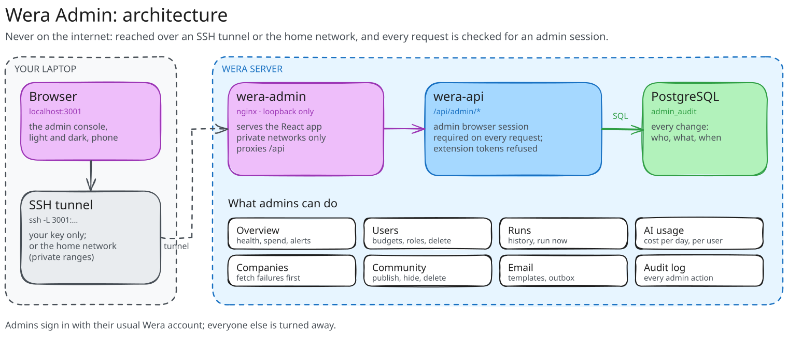

# Wera Admin

[](https://github.com/jessechumo/wera-admin/actions/workflows/ci.yml)
[](https://github.com/jessechumo/wera-admin/actions/workflows/ci.yml)
[](tsconfig.json)
[](https://www.conventionalcommits.org)
[](LICENSE)

The admin console for a [Wera](https://github.com/jessechumo/Wera) server. Admins sign in with their usual Wera account; everyone else is turned away. It talks only to the API's `/api/admin/*` routes, which check for an admin's browser session on every request and record every change in an audit log.

The user dashboard ([Wera-Frontend](https://github.com/jessechumo/Wera-Frontend)) has no admin features of its own.

<picture>
  <source media="(prefers-color-scheme: dark)" srcset="docs/architecture-dark.svg">
  
</picture>

## What it does

- **Overview:** users (with a profile, active this week, new), open jobs and new ones in the last 24 hours, matches waiting for a score, AI spend against the monthly cap, the last pipeline run, email status, and a **Needs attention** list (a failed run, companies whose fetch failed, content hidden by moderation, failed email, spend near the cap) that links to each fix. Refreshes every 30 seconds.
- **Users:** every account with its sign-ins, profile, matches, applications and AI spend against its budget; search and filters (admins, no profile, budget used up, inactive 30 days). Open one to rename it, change its monthly AI budget, grant or remove the admin role, **sign it out everywhere** (sessions and extension connections), or **delete** it after typing its email. An admin cannot remove their own role or delete themselves.
- **Runs:** every pipeline run with what it fetched, filtered, scored and cost, new jobs per run, and the error of a failed run; **Run now** starts one (and says so when one is already going).
- **AI usage:** cost and tokens per day, totals and cache hit rate, and each user's spend this month.
- **Companies:** every watched company and its last fetch, failures first, with the error.
- **Community:** moderation of posts and comments. The AI moderates everything as it is written; here admins publish what it hid by mistake, hide what it let through, or delete (a post with its comments).
- **Email:** whether sending is on, a preview of every template (HTML or text, desktop or phone width), a test send, and the outbox with failures.
- **Audit log:** who changed which account, moderated what, started a run or sent a test, and when.

Light and dark themes, a phone layout, and charts that load only with the pages that draw them. The console is made to be left open: it refreshes by itself, keeps what it shows when the API stops answering, and recovers without a click.

## Run it

It needs a Wera API (`wera serve`), and an admin account on it. To make an account an admin:

```sh
docker exec wera-api /app/wera users admin --email you@example.com   # on the server
```

Development, against an API on :8080 (or set `WERA_API`):

```sh
npm install
npm run dev        # http://localhost:5175
```

Checks:

```sh
npm run lint && npm run typecheck && npm test   # coverage: npm run coverage
```

### Deploy

The Docker image is nginx serving the built app and proxying `/api` to `wera-api:8080` on the Compose network. The Wera API repository's `docker-compose.yml` runs it as `wera-admin` on port 3001 next to the dashboard (`../wera-admin` beside `../wera`).

nginx answers **private networks only** (10.0.0.0/8, 172.16.0.0/12, 192.168.0.0/16 and the host itself). Keep it that way: the admin console is not meant to be published through the public tunnel.

Signing in here and on the dashboard share the API's session cookie when both are served from the same host, so signing out of one signs out of the other.

## Stack

React 19, TypeScript 6 (strict), Vite 8, Tailwind CSS 4, TanStack Query, React Router, Recharts; Vitest and Testing Library for tests. The design tokens, logo and theme match the dashboard.

## Commits and releases

Every commit is a [Conventional Commit](https://www.conventionalcommits.org) (`feat:`, `fix:`, `chore:`…), checked on pull requests. Work lands on `dev`; release-please keeps a release PR open on `main`, and merging it tags `wera-admin-vX.Y.Z` and publishes `ghcr.io/jessechumo/wera-admin`.
